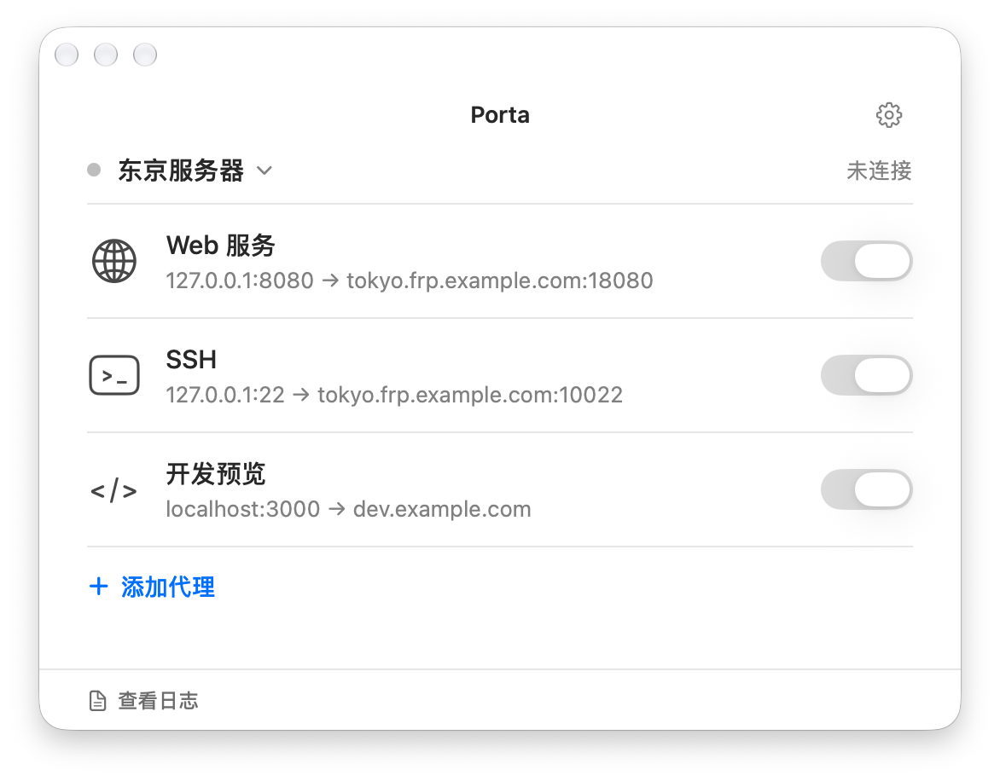

<p align="center">
  
</p>

<h1 align="center">Porta</h1>

<p align="center">
  <strong>A native macOS FRP client application built with Swift 6 and Apple Network.framework</strong>
</p>

<p align="center">
  A native macOS desktop client for FRP (Fast Reverse Proxy), implemented in Swift 6 with modern concurrency and Apple <code>Network.framework</code>.
</p>

<p align="center">
  <a href="https://swift.org"></a>
  <a href="https://developer.apple.com/macos"></a>
  <a href="https://github.com/fatedier/frp"></a>
  
  
  
  <a href="LICENSE"></a>
</p>

<p align="center">
  <a href="#installation">Installation</a> •
  <a href="#quick-start">Quick Start</a> •
  <a href="#configuration">Configuration</a>
</p>

<p align="center">
  <a href="README.md">简体中文</a> | <a href="README_EN.md"><strong>English</strong></a>
</p>

<p align="center">
  
</p>

---

## Introduction

**Porta** is an FRP (Fast Reverse Proxy) client desktop application developed for macOS, built with Swift 6 and Apple native frameworks, compatible with the official [fatedier/frp](https://github.com/fatedier/frp) server communication protocol.

Compared to running command-line binaries in a terminal or using Electron-based wrappers, Porta provides a native macOS interface and system-level integrations:
- **Native Network and Cryptography Stack**: Uses Apple native `Network.framework` and `CryptoKit`, without requiring the Go runtime or third-party dynamic libraries.
- **Swift 6 Concurrency Model**: State isolation managed via Actors combined with structured concurrency (`async`/`await`) to eliminate data races.
- **Yamux Multiplexing**: Includes an in-house pure Swift Yamux implementation supporting multiple streams over a single TCP/TLS physical connection.
- **Desktop Integration**: Provides menu bar residency, server configuration switching, port collision alerts, and a log inspection panel.

---

## Installation

Download the latest release package from [GitHub Releases](https://github.com/miwuyouth/Porta/releases):
- **`Porta-{version}.dmg`**: Open and drag `Porta.app` into your `Applications` folder;
- **`Porta-{version}-{sha}.zip`**: Extract and run.

> Requirements: macOS 14.0 (Sonoma) or newer. Universal binary natively supporting Apple Silicon (M1–M4) and Intel Macs.
>
> If macOS displays an "unverified developer" or "damaged" prompt on first launch due to Gatekeeper quarantine, run `xattr -cr /Applications/Porta.app` in Terminal, or go to "System Settings → Privacy & Security" and click "Open Anyway".

---

## Quick Start

1. **Launch**: Open Porta and click the menu bar status icon to view the main window.
2. **Configure Server**: Press `⌥⌘M` or click the gear icon to open server management, entering the FRP server address, port, and authentication token.
3. **Add Proxy**: Press `⌘N` to create a proxy rule, choose the type (TCP, HTTP, UDP, STCP), and specify local/remote ports or domains.
4. **Connect & Status**: Click the toggle to connect. If a remote port conflict occurs, error details appear at the top of the interface.
5. **View Logs**: Press `⌘L` to open the log window for level-based filtering and search.

---

## Configuration

Porta's configuration format is fully compatible with official FRP. For detailed `frpc.toml` syntax, options, and advanced configuration guides, please refer to the official [fatedier/frp documentation](https://github.com/fatedier/frp).

---

## Protocol & Feature Matrix

| Category | Feature | Status | Details |
| :--- | :--- | :---: | :--- |
| **Control Signaling** | Login / LoginResp | Supported | Aligned with v0.50 ~ v0.71+ protocol specs, RunID session binding |
| | NewProxy / NewProxyResp | Supported | Proxy registration flow & remote port allocation handling |
| | ReqWorkConn / StartWorkConn | Supported | Dispatches incoming work connections to target proxies |
| | Ping / Pong Heartbeats | Supported | Periodic heartbeat probing with auto-reconnection |
| **Transport** | Yamux Multiplexing (`tcpMux = true`) | Supported | Pure Swift implementation with flow control and stream multiplexing |
| | TCP Direct Mode (`tcpMux = false`) | Supported | Establishes independent physical TCP connections per worker |
| | TLS Transport Encryption | Supported | Built on Apple `Network.framework` native TLS with SNI |
| **Proxy Types** | TCP Proxy | Supported | Bidirectional stream bridging |
| | UDP Proxy | Supported | Full packet slicing and encapsulation handling |
| | HTTP Proxy | Supported | Supports `customDomains`, `subdomain`, `locations`, and host rewrites |
| | HTTPS Proxy | Supported | HTTPS reverse proxy tunneling support |
| | STCP Private Tunnels | Supported | Encrypted using AES-CFB 128-bit symmetric cipher |
| **Reliability & UX** | Port Conflict Diagnostics | Supported | Detects conflicting ports and displays actionable UI feedback |
| | Graceful Shutdown | Supported | Catches system termination signals and tears down virtual links |
| | Multi-server Hot Switching | Supported | Switch between server presets directly in GUI |
| | Automated Tests | Supported | 246 unit and integration test cases |

---

## Repository Structure

```
Porta/
├── Package.swift               # SPM package manifest
├── project.yml                 # XcodeGen configuration for Porta.xcodeproj
├── logo.png                    # Project logo
├── frpc.toml                   # Sample configuration
├── scripts/
│   └── package.sh              # Build and packaging script (DMG & ZIP)
├── Porta/                      # macOS SwiftUI application source code
│   ├── App/                    # Application lifecycle & AppDelegate
│   ├── Views/                  # UI views (main window, settings, live logs)
│   ├── Services/               # Process and log management, config generation
│   └── Assets.xcassets/        # Native icons and colors
├── Sources/
│   └── FRPClient/              # FRP protocol and network engine in Swift
└── Tests/
    └── FRPClientTests/         # 246+ unit and integration test suite
```

---

## Roadmap

- [x] Pure Swift 6 protocol alignment and actor state machine
- [x] Pure Swift Yamux multiplexing engine
- [x] Porta macOS menu bar & desktop app (SwiftUI)
- [x] Port conflict detection and real-time log inspector
- [x] 246 automated test cases passing
- [ ] XTCP P2P direct NAT traversal
- [ ] QUIC / KCP transport mode extension
- [ ] Homebrew Cask formula (`brew install --cask porta`)

---

## Contributing

Contributions are welcomed:

1. Fork the repository;
2. Create a feature branch: `git checkout -b feature/your-feature`;
3. Run test suite: `swift test`;
4. Commit and push your changes;
5. Open a Pull Request.

---

## License

This project is licensed under the [MIT License](LICENSE).
